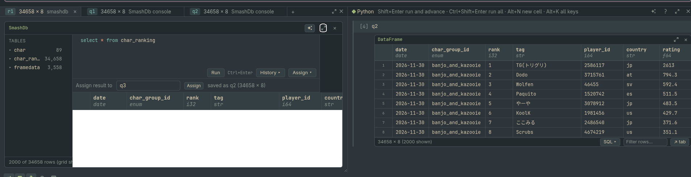

# cant see my error logs (teach how can see that and diagnos for me)
Here's a Wikipedia example. It reads a page and pulls one fact from it:

/assign ultimate_roster = the number of playable fighters listed in Super Smash Bros. Ultimate from https://en.wikipedia.org/wiki/Super_Smash_Bros._Ultimate
󰆏
The line under the code will say the value comes from a web page. The AI reads the page when you run it, and the value isn't checked. Wikipedia pages are usually quick, a few seconds, since they don't need a browser.

󰆏
$0.00037 · 8.81k in (89% cached) · 344 out · 1 request
▸
/assign
ultimate_roster = the playable fighters listed in Super Smash Bros. Ultimate from https://en.wikipedia.org/wiki/Super_Smash_Bros._Ultimate · the AI writes the code, you run it
class Fighter(BaseModel, frozen=True):
    name: str  # the fighter's name as listed on the page

ultimate_roster = from_url("https://en.wikipedia.org/wiki/Super_Smash_Bros._Ultimate", list[Fighter], "the playable fighters listed in Super Smash Bros. Ultimate")
from a web page: filled by AI when run, not checked · $0.0015 · 12.1k in · 481 out · 1 request
Enter runs · Escape drops
Run
Drop
󰆏
Not assigned: from_url didn't find it: The article gives only a count (74 base-game fighters, 89 with DLC) and names the 11 newcomers and the DLC fighters in prose. It never lists the full roster; the complete list is on the separate 'List of Super Smash Bros. series characters' article, which is not the URL requested.
▸
from_url
from_url (https://en.wikipedia.org/wiki/Super_Smash_Bros._Ultimate): browser, not found: The article gives only a count (74 base-game fighters, 89 with DLC) and names the 11 newcomers and the DLC fighters in prose. It never lists the full roster; the complete list is on the separate 'List of Super Smash Bros. series characters' article, which is not the URL requested., 16 s, $0.008
for error above can you show me link that did have characters󰃤
󰆏
I don't see an error in our chat, so please paste the message from the failed run and I'll help with it. I can't run /assign myself.

For a page with characters, the same Wikipedia article has a roster section listing the playable fighters:

/assign ultimate_fighters = the names of the playable fighters listed on the roster from https://en.wikipedia.org/wiki/Super_Smash_Bros._Ultimate
󰆏
I haven't opened the page to confirm its current layout, so if the result comes back empty or wrong, the error text will show what went wrong.

need to have the table widget just display, need to have think of it as panes that bordered into. perhaps general console designs pricipals (also remove any boarders from widgets, no boarders/or space complete maximize screen space)

